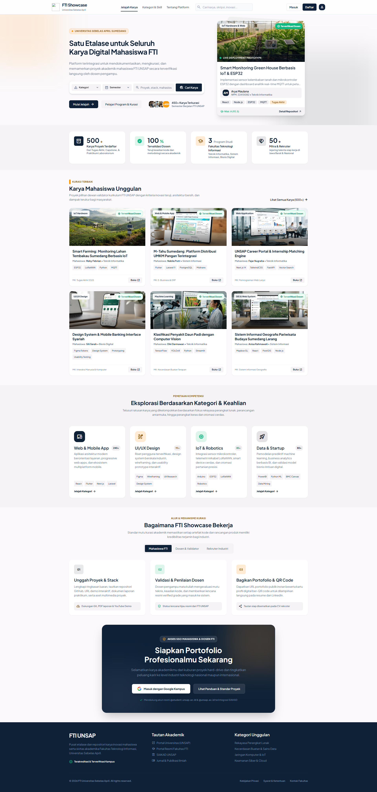
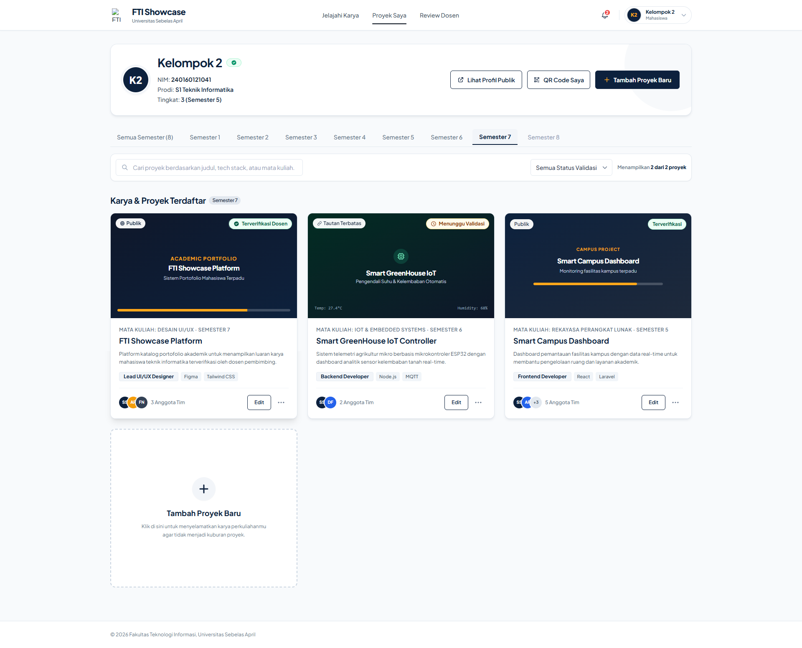
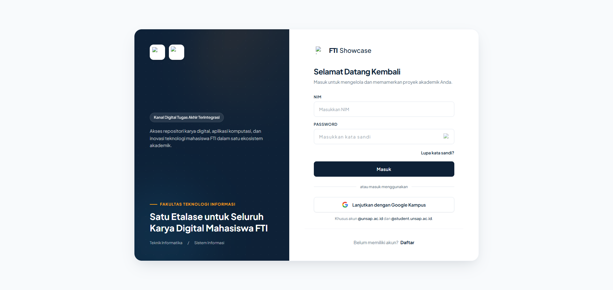
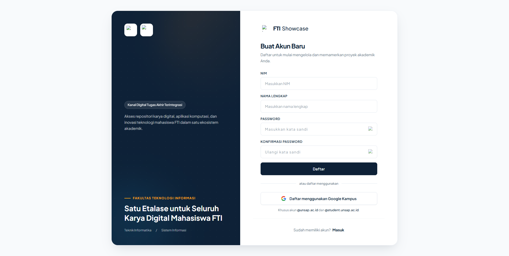
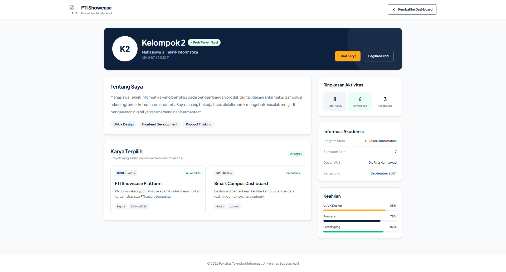
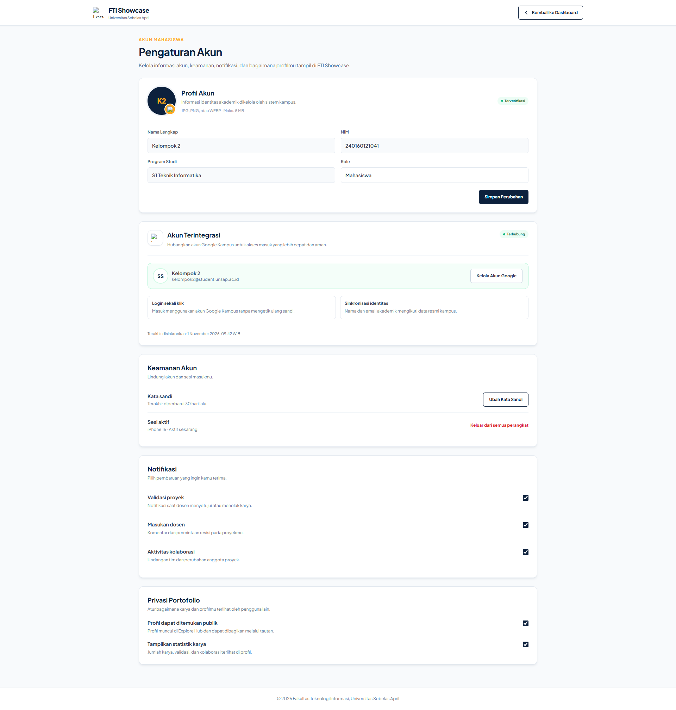

# 🚀 FTI SHOWCASE

## 📝 Deskripsi & Tema Proyek
Tema proyek kolaboratif kelompok kami adalah **FTI Showcase atau PortoFTI (Portfolio and Career Project Hub)**[cite: 3].

Jadi, proyek ini berangkat dari permasalahan hasil tugas dan proyek perkuliahan mahasiswa yang sering kali hanya tersimpan di laptop atau Google Drive dan akhirnya tidak digunakan lagi setelah UAS selesai[cite: 3].

Padahal, sebenarnya hasil proyek tersebut bisa menjadi bukti kemampuan dan pengalaman mahasiswa, terutama untuk membangun portofolio ketika ingin melamar pekerjaan atau mengikuti kegiatan profesional[cite: 3].

Oleh karena itu, kelompok kami memiliki ide untuk membuat sebuah platform berbasis web yang dapat digunakan mahasiswa FTI untuk mengunggah, menyimpan, dan memamerkan hasil proyek perkuliahan mereka[cite: 3].

Di dalam platform ini, mahasiswa dapat mengunggah karya dan melengkapi informasi proyek[cite: 3]. Selanjutnya, dosen dapat melakukan pemeriksaan dan memberikan persetujuan atau meminta perbaikan[cite: 3]. Jika sudah disetujui, proyek tersebut dapat ditampilkan di halaman portofolio publik sehingga bisa dilihat oleh pengunjung maupun calon perekrut[cite: 3].

Jadi, tujuan utama proyek kami bukan hanya menyediakan tempat penyimpanan tugas, tetapi bagaimana karya mahasiswa yang sebelumnya hanya menjadi tugas perkuliahan bisa dikembangkan menjadi portofolio profesional yang memiliki nilai lebih untuk masa depan mereka[cite: 3].

---

## 📸 Tampilan Utama & Antarmuka Aplikasi

### 1. Landing Page (Dashboard Publik)
[cite: 2]

### 2. Dashboard Mahasiswa
[cite: 2]

### 3. Halaman Autentikasi (Masuk & Daftar)
| Halaman Masuk (Login) | Halaman Daftar (Register) |
| :---: | :---: |
| [cite: 2] | [cite: 2] |

### 4. Profil Mahasiswa & Pengaturan Akun
| Profil Mahasiswa | Pengaturan Akun |
| :---: | :---: |
| [cite: 2] | [cite: 2] |

---

## 🛠️ Teknologi yang Digunakan
- HTML5 / CSS3 / JavaScript[cite: 3]
- Tailwind CSS / Bootstrap[cite: 3]
- PHP / Laravel 13[cite: 3]
